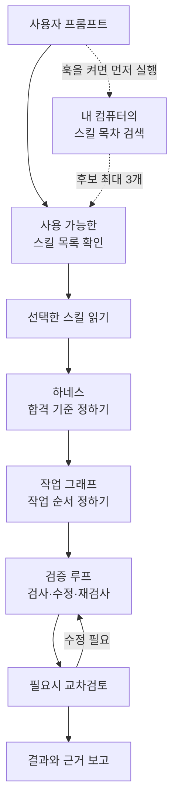

# Engineering Workflow

[English](README.md)

완료 기준, 작업 순서, 검증 결과를 한 흐름으로 관리하는 Agent Skill입니다. 사용자 범위로 설치하면 여러 프로젝트에서 사용할 수 있습니다.

## 아키텍처

**설치할 때.** Codex나 Claude Code에 GitHub 저장소를 마켓플레이스로 등록하고 플러그인을 설치하면, 도구가 로컬에 스킬 사본을 보관합니다. 다른 Agent Skills 지원 도구에는 같은 스킬 폴더를 직접 설치할 수 있습니다.

**프롬프트를 보낼 때.** 인덱스는 설치된 스킬의 **이름·짧은 설명·파일 경로**를 모은 목차입니다. 프롬프트를 보낼 때 실행되는 훅(`UserPromptSubmit`)을 설정하면 내 컴퓨터의 목차 파일(`skill-index.json`)을 먼저 검색해 후보 이름을 최대 3개 전달합니다. 도구가 현재 사용 가능한 후보를 확인한 뒤 선택한 `SKILL.md`와 필요한 참고 문서만 읽습니다. 플러그인만 설치한 경우에는 도구 자체의 스킬 목록을 사용합니다.

**영어로 쓰는 부분.** 이 플러그인의 스킬 설명과 실행 지침은 영어입니다. 프롬프트는 한국어로 쓸 수 있습니다. 예를 들어 “하네스랑 교차검토 써 줘”라고 하면 로컬 검색이 `하네스`를 `harness`로, `교차검토`를 `independent review`로 찾아봅니다. 영어 지침과 필요한 파일만 읽는 방식의 토큰 절감량은 별도로 측정해야 합니다.

**실선**은 기본 작업 흐름입니다. **점선**은 훅을 설정했을 때 추가되는 검색 경로입니다. 교차검토에서 수정이 필요하면 실선을 따라 재검사로 돌아갑니다.



공용 입력 처리기(파서)를 고치는 경우를 예로 들면, 세 부분은 이렇게 연결됩니다.

| 구성 | 역할 | 예시 |
| --- | --- | --- |
| 하네스 | 작업 범위와 완료에 필요한 검사를 정합니다. | 정상 입력은 기존대로 처리하고, 잘못된 입력에는 정해진 오류를 돌려줘야 합니다. |
| 작업 그래프 | 선행 조건을 적고 동시에 진행할 수 있는 작업을 찾습니다. | 파서의 입력·출력 약속을 확인하고 파서를 수정한 뒤, 파서를 쓰는 두 기능을 각각 확인합니다. |
| 검증 루프 | 현재 변경을 검사하고 실패 원인을 고친 뒤 영향받은 검사를 다시 돌립니다. | 한 기능에서 오류가 나면 재현 입력을 만들고, 원인을 고친 뒤 그 입력으로 다시 확인합니다. |

작업 그래프는 최종 변경 사항을 보고 검사 경로를 고릅니다. 문구나 이미지만 교체하면 변경 내용과 표시를 직접 확인하고, 프로젝트가 요구하는 경우에 자동 테스트를 실행합니다. 동작 변경이 포함되면 해당 동작도 테스트합니다. [검증 흐름](docs/workflow-flow.md)

요청이 있거나 공용 계약, 데이터, 권한, 배포에 영향이 있으면 교차검토로 최종 변경과 검증 근거를 확인합니다. 마지막 보고에는 결과, 실행한 검사, 남은 문제, 실제 적용한 스킬, 모델과 추론 강도, 확인한 사용량이 들어갑니다. 모델 선택이 가능한 도구에서는 역할마다 해당 작업을 감당할 수 있는 가장 가벼운 모델을 사용합니다. 세션 설정이 고정되어 있으면 도구가 지정한 모델과 추론 강도를 보고합니다.

플러그인을 설치하면 훅 하나가 함께 등록됩니다. 어시스턴트가 턴을 마치면 저장소에 남은 변경을 커밋하고 푸시합니다. 이 하네스는 개인 프로젝트용이라, 끝난 작업을 커밋 요청이 올 때까지 붙들어 두지 않습니다. [훅](#훅) 절을 보세요. Slack·Discord MCP는 필요할 때 관련 맥락을 읽는 선택 사항입니다. [스킬 인덱스 안내](plugins/engineering-workflow/skills/engineering-workflow/references/skill-index.md) · [MCP 연동](docs/mcp-setup.md)

## 설치

### Codex CLI와 데스크톱 앱

```sh
codex plugin marketplace add leejungmin91/engineering-workflow --ref main
codex plugin add engineering-workflow@engineering-workflow
```

이전 태그를 고정해 등록했다면 `codex plugin marketplace remove engineering-workflow`를 실행한 뒤 새 버전을 등록합니다.

Codex 데스크톱 앱에서는 마켓플레이스를 등록한 뒤 앱을 재시작합니다. 플러그인 디렉터리의 **Engineering Workflow** 소스에서 같은 이름의 플러그인을 설치하고 새 채팅을 엽니다. [Codex 마켓플레이스 공식 문서](https://developers.openai.com/plugins/build/plugins#add-a-marketplace-from-the-cli)

### Claude Code

```sh
claude plugin marketplace add https://github.com/leejungmin91/engineering-workflow.git
claude plugin install engineering-workflow@engineering-workflow
```

새 세션에서 `/engineering-workflow:engineering-workflow`로 실행합니다. Claude Code 2.1.275 이상에서는 세션 안에서 다음 명령으로 설치 화면을 열 수 있습니다.

```text
/plugin install engineering-workflow --marketplace leejungmin91/engineering-workflow
```

업데이트하려면 `claude plugin marketplace update engineering-workflow`와 `claude plugin update engineering-workflow@engineering-workflow`를 차례로 실행하고 Claude Code를 재시작합니다. [Claude Code 마켓플레이스 공식 문서](https://code.claude.com/docs/en/plugin-marketplaces)

### Claude 데스크톱, 웹, Cowork

**Customize → Plugins → Add → Add marketplace**에서 `leejungmin91/engineering-workflow` 저장소를 등록하고, 해당 소스의 **Engineering Workflow**를 추가합니다. 사용 가능한 마켓플레이스와 도구는 요금제 및 조직 설정에 따라 달라집니다. [Claude 앱 플러그인 공식 문서](https://support.claude.com/en/articles/13837440-use-plugins-in-claude)

### Cursor, Gemini CLI, 그 외 Agent Skills 지원 도구

[engineering-workflow 스킬 폴더](plugins/engineering-workflow/skills/engineering-workflow) 전체를 사용하는 도구의 스킬 경로에 복사합니다. Cursor와 Gemini CLI에서 사용자 범위 경로는 `~/.agents/skills/`입니다. 텍스트 지침만 받는 앱에서는 `SKILL.md`를 지침으로 제공하고 앱에서 제공하는 도구로 실행합니다. [Cursor](https://prod.cursor.com/docs/skills) · [Gemini CLI](https://github.com/google-gemini/gemini-cli/blob/main/docs/cli/using-agent-skills.md)

## 훅

플러그인은 Claude Code와 Codex에 `Stop` 훅을 제공합니다. Codex CLI에서는 `/hooks`, 데스크톱 앱에서는 **설정 → Hooks**에서 훅을 검토하고 신뢰를 승인합니다. [Codex 훅 승인 안내](https://learn.chatgpt.com/docs/hooks#review-and-trust-hooks)

| 훅 | 이벤트 | 동작 |
| --- | --- | --- |
| `auto_commit_push` | `Stop` | 어시스턴트가 턴을 마치면 `git add -A`로 남은 변경을 스테이징하고 `Update <최상위 경로>` 제목으로 커밋합니다. 로컬 커밋은 저장소의 Git 설정에 따라 푸시합니다. 업스트림이 없고 `origin`이 있으면 같은 이름의 원격 브랜치로 푸시합니다. |

작업 트리가 깨끗해도 직접 만든 로컬 커밋을 푸시합니다. 실패는 메시지로 알리며, 커밋이 로컬에 남아 있으면 다음 턴 종료 시 푸시를 재시도합니다. `AUTO_COMMIT_TRAILER`로 `Co-Authored-By` 트레일러를 바꾸고, `--dry-run`으로 임시 Git 인덱스를 사용해 커밋을 미리 볼 수 있습니다.

필요한 것과 한계:

- PATH에 POSIX `sh`와 `git`이 있어야 합니다(Git for Windows에 둘 다 포함). 훅에는 Python이 필요하지 않습니다.
- `.gitignore`가 제외하지 않은 것은 턴 끝에 남은 미완성 수정까지 모두 커밋됩니다. 비밀 값은 검사하지 않으므로 `.gitignore`, 호스트 권한, 브랜치 보호 규칙으로 막습니다.
- 훅을 끄려면 플러그인을 끄거나 지워야 하며, 그러면 스킬도 함께 꺼집니다.

훅 시험은 [`tools/hook_tests`](tools/hook_tests)에 있고 `python -m unittest discover -s tools/hook_tests`로 실행합니다. 임시 Git 저장소와 bare 원격을 만들어 훅을 실제로 돌려 봅니다.

## 사용 예시

> Engineering Workflow로 이 변경이 영향을 주는 기능을 찾아 줘. 작업 순서와 합격 기준을 정하고, 실행한 검사와 남은 문제를 구조도와 함께 보고해 줘.

저장소를 내려받았다면 Python 3.9 이상에서 선택형 검사 도구를 실행할 수 있습니다. 아래 예제는 회귀 검사 실패, 이전 변경 상태에서 실행된 린트, 대기 중인 UI 검사를 보고합니다.

```sh
python plugins/engineering-workflow/skills/engineering-workflow/scripts/check_record.py examples/incomplete.json --snapshot current
```

[검증 기록 형식](plugins/engineering-workflow/skills/engineering-workflow/references/harness-record.md)

### 사용량 표시

#### Codex CLI

`/statusline`에서 터미널 하단에 표시할 항목을 고를 수 있습니다. 또는 `~/.codex/config.toml`의 기존 `[tui]` 아래에 다음 배열을 넣고 Codex CLI를 다시 실행하세요. [Codex CLI 명령](https://learn.chatgpt.com/docs/developer-commands?surface=cli#configure-footer-items-with-statusline)

```toml
[tui]
status_line = ["model-with-reasoning", "context-used", "context-remaining", "context-window-size", "used-tokens", "five-hour-limit", "weekly-limit"]
```

하단에는 모델과 추론 강도, 컨텍스트 사용률과 용량, 세션 누적 토큰, 제공되는 계정 한도가 표시됩니다. Python 3와 현재 Codex 세션 기록에 접근할 수 있으면 하네스도 최신 수치를 읽어 최종 보고에 넣습니다.

#### Claude Code

[`integrations/statusline/claude-usage.sh`](integrations/statusline/README.md)는 대화 컨텍스트, 전체 계정 한도(`All · 5h` / `All · 7d`), 페이블 등 모델별 주간 한도(`Fable · 7d`)를 줄별로 구분합니다. 바에는 사용률·남은 비율, 컨텍스트의 사용 토큰·용량, 계정 한도의 초기화 시각이 표시됩니다. 모델별 한도는 Claude Code의 로컬 사용량 캐시에서 읽어 갱신 후 경과 시간을 함께 보여 주며, 값이 없으면 확인 불가로 표시합니다. 파일을 `~/.claude/statusline-usage.sh`로 복사하고(기존 설치를 갱신할 때도 다시 복사), `~/.claude/settings.json`에 `statusLine` 명령을 추가하세요. 플러그인은 상태 줄을 설정할 수 없어 설정은 한 번 직접 추가해야 합니다. `sh`와 `jq`가 필요합니다.

```json
"statusLine": { "type": "command", "command": "sh ~/.claude/statusline-usage.sh", "padding": 0 }
```

## 참고한 스킬 10개

플러그인이 제공하는 스킬은 `engineering-workflow` 하나입니다. 아래 스킬에서 가져온 작업 방식을 이 스킬에 반영했습니다.

| 참고 스킬 | 가져온 작업 방식 |
| --- | --- |
| Matt Pocock · `diagnosing-bugs` | 수정 전에 같은 오류를 재현하는 가장 작은 입력부터 찾습니다. |
| Superpowers · `verification-before-completion` | 마지막 변경 상태에서 통과한 검사를 완료 근거로 사용합니다. |
| ECC · `eval-harness` | 성공 조건과 회귀 사례를 정하고, 같은 사례로 워크플로 변경 전후를 비교합니다. |
| Karpathy Skills · `karpathy-guidelines` | 작업 범위와 확인 기준을 먼저 정해 필요한 부분만 수정합니다. |
| Anthropic · `webapp-testing` | 실행 환경이 있으면 실제 화면에서 영향받은 사용자 경로를 확인합니다. |
| Ponytail · `ponytail` | 새 코드나 도구를 추가하기 전에 기존에 쓸 수 있는 것을 찾습니다. |
| UI UX Pro Max · `ui-ux-pro-max` | UI 검사에 접근성과 영향받는 화면 크기를 포함합니다. |
| Graphify · `graphify` | 확인한 작업 의존성과 아직 추정에 그치는 의존성을 표시합니다. |
| gstack · `review` | 최종 변경에서 공용 계약, 데이터, 권한에 미치는 영향을 검토합니다. |
| Caveman · `caveman` | 결과와 근거부터 짧게 전달하고 중요한 조건을 함께 남깁니다. |

[스킬 선정 기준과 원본 커밋](plugins/engineering-workflow/skills/engineering-workflow/references/source-skills.md)

## 더 읽기

- [전체 실행 흐름·교차검토·보고서 구조도](docs/workflow-flow.md)
- [여러 도구로 배포한 작업 보고서](docs/implementation-report.md)
- [훅 범위와 선택형 스킬 색인 훅](plugins/engineering-workflow/skills/engineering-workflow/references/hook-recommendations.md)
- [플러그인 색인](plugins/engineering-workflow/INDEX.md) · [변경 이력](plugins/engineering-workflow/CHANGELOG.md)
