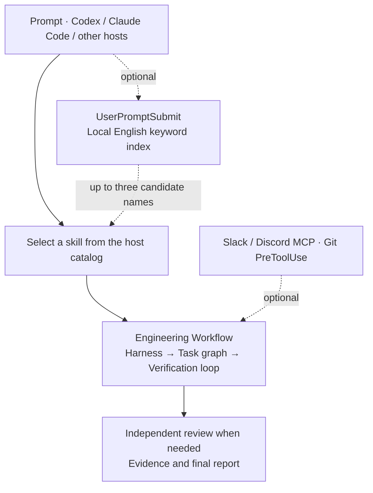

# Engineering Workflow

One portable Agent Skill for harness engineering, verification loops, and task dependency graphs. Use it from a CLI or an app and add Slack or Discord context when the task needs it.

## Architecture



When the host lets you choose a model, use the smallest capable one for each role. Use a lightweight model for routine edits, a standard model for integration or debugging, and a more capable model for architecture or high-risk reviews. [Superpowers](https://github.com/obra/superpowers)

See the [skill discovery and index guide](plugins/engineering-workflow/skills/engineering-workflow/references/skill-index.md) for native lookup and the optional prompt hook.

The optional completion checker compares recorded checks with the current work snapshot. See the [full workflow and report handoff](docs/workflow-flow.md).

## Install

### Codex CLI and desktop app

```sh
codex plugin marketplace add leejungmin91/engineering-workflow --ref v0.4.0
codex plugin add engineering-workflow@engineering-workflow
```

If you registered a previous pinned version, run `codex plugin marketplace remove engineering-workflow` before adding the new version.

In Codex desktop, restart after adding the marketplace and install **Engineering Workflow** from the **Engineering Workflow** source in the Plugins Directory. Open a new chat to use the skill. [Codex marketplace docs](https://developers.openai.com/plugins/build/plugins#add-a-marketplace-from-the-cli)

### Claude Code

```sh
claude plugin marketplace add https://github.com/leejungmin91/engineering-workflow.git
claude plugin install engineering-workflow@engineering-workflow
```

In a new session, run `/engineering-workflow:engineering-workflow`. On Claude Code 2.1.275 or later, the in-session command below opens the installation screen.

```text
/plugin install engineering-workflow --marketplace leejungmin91/engineering-workflow
```

To update an existing installation, run `claude plugin marketplace update engineering-workflow` and then `claude plugin update engineering-workflow@engineering-workflow`. Restart Claude Code to apply the update.

[Claude Code marketplace docs](https://code.claude.com/docs/en/plugin-marketplaces)

### Claude Desktop, web, and Cowork

Open **Customize → Plugins → Add → Add marketplace**. Add `leejungmin91/engineering-workflow` as a repository, then add **Engineering Workflow** from that source. Your plan and organization policy control which marketplaces and tools are available. [Claude app plugin docs](https://support.claude.com/en/articles/13837440-use-plugins-in-claude)

### Cursor, Gemini CLI, and other Agent Skills hosts

Copy the entire [engineering-workflow skill directory](plugins/engineering-workflow/skills/engineering-workflow) into your tool's Agent Skills directory. Cursor and Gemini CLI both document `~/.agents/skills/` for user-wide use. For other hosts, use their documented location. In a chat app that only accepts text, provide the SKILL.md as instructions and use the app's available tools. [Cursor](https://prod.cursor.com/docs/skills) · [Gemini CLI](https://github.com/google-gemini/gemini-cli/blob/main/docs/cli/using-agent-skills.md)

## Use

> Use Engineering Workflow to identify what depends on this change, run the required checks, and report the result with a diagram.

The workflow defines the acceptance checks, orders the work, and revisits failed checks after a focused change. The optional checker uses Python 3.9 or later to validate the completion record against the current work snapshot.

```sh
python plugins/engineering-workflow/skills/engineering-workflow/scripts/check_record.py examples/incomplete.json --snapshot current
```

The example reports a failed regression, stale lint evidence, and a pending UI check. See the [record format](plugins/engineering-workflow/skills/engineering-workflow/references/harness-record.md).

## 한국어

위 구조도는 **스킬 검색 → 합격 기준 → 작업 순서 → 구현·재검사 → 교차검토 → 보고**를 보여 줍니다. 검토에서 수정할 점을 찾으면 영향을 받은 검사로 돌아가고, 막히면 확인한 근거와 남은 문제를 보고합니다.

위 설치 절차 중 사용하는 CLI나 앱을 선택한 뒤 새 채팅에서 이렇게 요청하세요.

> Engineering Workflow로 작업 순서와 합격 기준을 정하고, 검증한 내용과 남은 문제를 다이어그램과 함께 보고해 줘.

- [Slack·Discord MCP 설치 안내](docs/mcp-setup.md)
- [전체 실행 흐름·교차검토·보고서 다이어그램](docs/workflow-flow.md)
- [다중 도구 배포 보고서](docs/implementation-report.md)
- [참고한 스킬 10개](plugins/engineering-workflow/skills/engineering-workflow/references/source-skills.md)
- [선택형 훅 도입안](plugins/engineering-workflow/skills/engineering-workflow/references/hook-recommendations.md)
