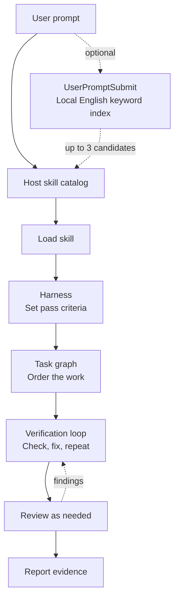

# Engineering Workflow

[한국어](README.ko.md)

One portable Agent Skill for harness engineering, verification loops, and task dependency graphs. Use it from a CLI or an app and add Slack or Discord context when the task needs it.

## Architecture

**Install.** Register the GitHub repository as a marketplace and install the plugin in Codex or Claude Code. The host keeps a local copy of the skill. Other Agent Skills hosts can load the same skill directory directly.

**Run.** When you submit a prompt, the host uses the names and descriptions in its skill catalog to select a skill and loads the selected `SKILL.md` and relevant references. If configured, the `UserPromptSubmit` hook searches a local English keyword index and suggests up to three skill names. The host confirms the candidates and decides which skill to load.



| Part | What it does | Example |
| --- | --- | --- |
| Harness | Defines scope, expected behavior, and the checks needed to finish. | A parser change must preserve valid input and return the expected error for invalid input. |
| Task graph | Records prerequisites and determines which steps can run independently. | Confirm the parser contract, update the parser, then check both callers in parallel. |
| Verification loop | Runs checks against the current change and rechecks the affected cases after a focused fix. | Reproduce a caller failure, fix the cause, and rerun its regression check. |

Independent review checks the diff and evidence when requested or when shared contracts, data, permissions, or deployments change. The final report lists the result, checks run, and open issues. When the host offers model selection, the workflow uses the lightest model suited to each role.

Slack and Discord MCP can provide task context. The separate Git `PreToolUse` hook checks selected Git commands before execution. Both integrations are optional. See the [skill index guide](plugins/engineering-workflow/skills/engineering-workflow/references/skill-index.md), [MCP setup](docs/mcp-setup.md), and [hook examples](integrations/hooks/README.md).

## Install

### Codex CLI and desktop app

```sh
codex plugin marketplace add leejungmin91/engineering-workflow --ref v0.4.0
codex plugin add engineering-workflow@engineering-workflow
```

If you registered a previous pinned version, run `codex plugin marketplace remove engineering-workflow` before adding the new version.

In Codex desktop, restart after adding the marketplace and install **Engineering Workflow** from the **Engineering Workflow** source in the Plugins Directory. Open a new chat to use the skill. [Codex marketplace docs](https://developers.openai.com/plugins/build/plugins#add-a-marketplace-from-the-cli)

### Claude Code

```sh
claude plugin marketplace add https://github.com/leejungmin91/engineering-workflow.git
claude plugin install engineering-workflow@engineering-workflow
```

In a new session, run `/engineering-workflow:engineering-workflow`. On Claude Code 2.1.275 or later, the in-session command below opens the installation screen.

```text
/plugin install engineering-workflow --marketplace leejungmin91/engineering-workflow
```

To update an existing installation, run `claude plugin marketplace update engineering-workflow` and then `claude plugin update engineering-workflow@engineering-workflow`. Restart Claude Code to apply the update.

[Claude Code marketplace docs](https://code.claude.com/docs/en/plugin-marketplaces)

### Claude Desktop, web, and Cowork

Open **Customize → Plugins → Add → Add marketplace**. Add `leejungmin91/engineering-workflow` as a repository, then add **Engineering Workflow** from that source. Your plan and organization policy control which marketplaces and tools are available. [Claude app plugin docs](https://support.claude.com/en/articles/13837440-use-plugins-in-claude)

### Cursor, Gemini CLI, and other Agent Skills hosts

Copy the entire [engineering-workflow skill directory](plugins/engineering-workflow/skills/engineering-workflow) into your tool's Agent Skills directory. Cursor and Gemini CLI both document `~/.agents/skills/` for user-wide use. For other hosts, use their documented location. In a chat app that only accepts text, provide the SKILL.md as instructions and use the app's available tools. [Cursor](https://prod.cursor.com/docs/skills) · [Gemini CLI](https://github.com/google-gemini/gemini-cli/blob/main/docs/cli/using-agent-skills.md)

## Use

> Use Engineering Workflow to identify what depends on this change, run the required checks, and report the result with a diagram.

The workflow defines the acceptance checks, orders the work, and revisits failed checks after a focused change. The optional checker uses Python 3.9 or later to validate the completion record against the current work snapshot.

```sh
python plugins/engineering-workflow/skills/engineering-workflow/scripts/check_record.py examples/incomplete.json --snapshot current
```

The example reports a failed regression, stale lint evidence, and a pending UI check. See the [record format](plugins/engineering-workflow/skills/engineering-workflow/references/harness-record.md).

## Source skills

The plugin ships one skill, `engineering-workflow`. Its workflow adapts techniques from these ten source skills.

| Source skill | Technique used here |
| --- | --- |
| Matt Pocock · `diagnosing-bugs` | Reproduce the failure with the smallest useful input before editing. |
| Superpowers · `verification-before-completion` | Use passing results from the final work snapshot as completion evidence. |
| ECC · `eval-harness` | Define success and regression cases, then compare the same cases before and after a workflow change. |
| Karpathy Skills · `karpathy-guidelines` | Set a clear scope and checks, and keep the diff focused. |
| Anthropic · `webapp-testing` | Verify the affected user flow in the actual interface when available. |
| Ponytail · `ponytail` | Look for existing code and tools before adding new ones. |
| UI UX Pro Max · `ui-ux-pro-max` | Include accessibility and relevant viewport sizes in UI checks. |
| Graphify · `graphify` | Mark task dependencies as confirmed or inferred. |
| gstack · `review` | Inspect the final diff for impact on shared contracts, data, and permissions. |
| Caveman · `caveman` | Lead with results and evidence while keeping important conditions visible. |

See the [source notes](plugins/engineering-workflow/skills/engineering-workflow/references/source-skills.md) for the selection method and links to the exact source revisions.

## Further reading

- [Workflow, cross-review, and report diagrams](docs/workflow-flow.md)
- [Multi-host implementation report](docs/implementation-report.md)
- [Optional hook recommendations](plugins/engineering-workflow/skills/engineering-workflow/references/hook-recommendations.md)
