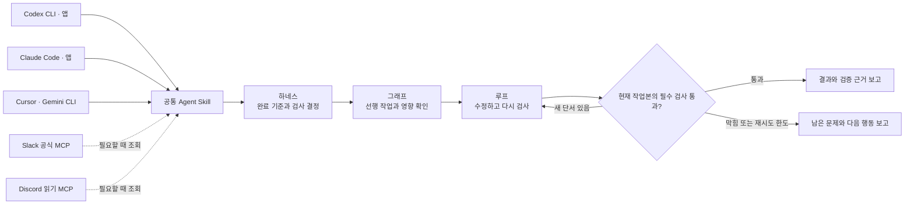

# Engineering Workflow v0.2.0 구현 보고서

## 목표

Codex에서 쓰던 하네스·루프·그래프 작업 절차를 여러 CLI와 앱에서 재사용할 수 있게 공개 저장소에 배포한다. Slack과 Discord는 작업에 필요한 맥락을 가져올 때 선택해서 연결한다.

## 바꾼 내용

| 영역 | 구현 |
| --- | --- |
| 공통 스킬 | 한 곳의 `SKILL.md`와 완료 기록 검사기를 Codex와 Claude 플러그인이 함께 사용한다. Cursor·Gemini CLI처럼 Agent Skills를 지원하는 도구는 같은 폴더를 설치한다. |
| CLI와 앱 | 기존 Codex 카탈로그를 유지하고 Claude 마켓플레이스 및 플러그인 설정을 추가했다. 앱에서는 각 제품의 마켓플레이스 화면에서 GitHub 소스를 추가한다. |
| Slack | Slack 공식 MCP와 워크스페이스 OAuth 연결 절차를 제공한다. |
| Discord | 로컬 MCP 도구 하나를 추가했다. 봇 권한이 있고 사용자가 지정한 채널에서만 최근 텍스트를 조회하며, 요청당 최대 20건을 반환한다. |
| 보고 | 요청 시 변경 내용, 검증 근거, 미확인 항목과 흐름도를 남기도록 스킬을 보완했다. |

## 구조

예를 들어 두 화면이 같은 파서를 사용한다고 가정한다. **하네스**는 파서 테스트와 두 화면 검사를 합격 기준으로 정한다. **그래프**는 파서부터 확인하고 두 화면을 이어서 검사할 순서를 정한다. 한 화면이 실패하면 **루프**는 원인을 고치고 영향받은 검사만 다시 한다. Slack이나 Discord는 실패가 처음 보고된 맥락을 찾는 데 필요할 때만 사용한다.

## 검증 및 남은 항목

- 완료 기록 검사기 8개와 Discord MCP 테스트 3개를 실행했다. Discord 테스트는 가상 응답에서 조회 메서드와 반환 필드를 확인하고, 실제 stdio로 도구를 등록해 허용되지 않은 채널이 거부되는지 확인한다.
- Codex CLI와 Claude Code의 설치 경로를 별도 임시 설정으로 검증했다. CI는 macOS·Windows·Linux에서 검사기와 Discord 테스트를 실행한다.
- 데스크톱 앱 설치 경로는 공식 문서에 근거해 제공했다. 앱 UI에서 실제 설치와 실행은 확인하지 않았다. Slack OAuth와 Discord 봇의 실제 채널 읽기에는 대상 워크스페이스·서버의 권한과 인증이 필요하다.
- 공개 배포에는 MCP 자동 등록을 포함하지 않았다. 사용자마다 계정과 채널이 다르고, 연결을 따로 등록해야 다른 팀의 기본 작업에 영향을 주지 않기 때문이다.

[설치 안내](../README.md) · [MCP 연결 안내](mcp-setup.md) · [Codex 마켓플레이스 문서](https://developers.openai.com/plugins/build/plugins) · [Claude 앱 플러그인 문서](https://support.claude.com/en/articles/13837440-use-plugins-in-claude)
