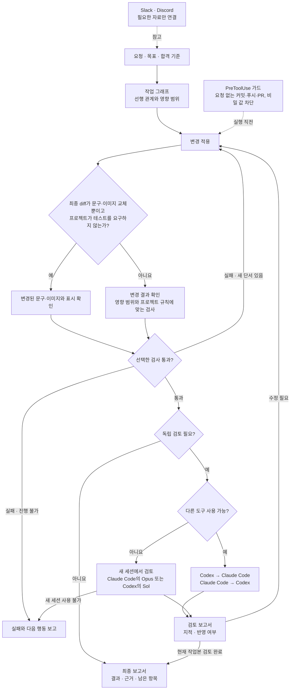

# Engineering Workflow v0.3.0 실행 흐름 보고서

Codex와 Claude Code가 같은 작업 스킬을 사용한다. 구현과 검토에 서로 다른 도구를 쓸 수 있으면 그 경로를 사용한다. 다른 도구에 접근할 수 없으면 Codex의 새 Sol 세션 또는 Claude Code의 새 Opus 세션에서 검토한다.

파서를 고친다면 **하네스**가 어떤 테스트를 통과해야 하는지 정하고, **그래프**가 파서를 사용하는 화면까지 검사 순서를 잡는다. 화면 하나가 실패하면 **루프**가 원인을 고쳐 다시 검사한다. 다른 검토자는 최신 변경과 테스트 결과를 읽어 빠진 경우를 찾는다. 최종 보고서에는 고친 것과 여전히 확인할 수 없는 것이 함께 남는다.

## 변경 범위별 검사 예시

| 최종 변경 | 검사 |
| --- | --- |
| 버튼 문구의 오타 수정 | 문구와 해당 화면의 표시를 확인한다. |
| 연결 경로와 표시 방식이 같은 이미지 교체 | 새 이미지가 의도대로 열리고 잘림 없이 표시되는지 확인한다. |
| 버튼 문구와 클릭 동작을 함께 수정 | 문구 표시를 확인하고 클릭 동작과 관련 회귀를 테스트한다. |
| 이미지 교체와 함께 로딩 설정 또는 빌드 설정 변경 | 새 이미지 표시를 확인하고 영향받은 로딩 경로나 빌드를 검사한다. |

문구·이미지만 바뀌는 작업에서는 프로젝트가 요구하는 경우에 자동 테스트를 실행한다. 최종 diff에서 동작 변경이 확인되면 영향받은 검사로 돌아간다.

## 내부에서 적용한 스킬

실행할 때 불러오는 스킬은 `engineering-workflow` 하나다. 아래 10개에서 가져온 규칙은 단계에 나눠 반영했다. [원문과 규칙 10개](../plugins/engineering-workflow/skills/engineering-workflow/references/source-skills.md)

| 적용 시점 | 가져온 스킬 | 실제 적용 |
| --- | --- | --- |
| 작업 범위 설정 | `karpathy-guidelines`, `ponytail` | 합격 기준부터 정하고 기존 코드와 도구를 먼저 본다. |
| 재현과 재검사 | `diagnosing-bugs`, `eval-harness`, `verification-before-completion` | 빠르게 재현하고 같은 사례로 비교하며 최신 작업본에서 확인한다. |
| 영향 관계 확인 | `graphify` | 확인된 의존성과 추정을 구분한다. |
| 화면 확인 | `webapp-testing`, `ui-ux-pro-max` | 실제 흐름과 접근성, 영향받는 화면 크기를 확인한다. |
| 교차검토 | gstack `review` | 검사와 별도로 diff에서 계약, 데이터, 권한 영향을 본다. |
| 결과 보고 | `caveman` | 결과와 근거부터 전달하고 중요한 조건을 남긴다. |

## 훅과 보고서

0.5.0부터 플러그인은 훅 **두 개**를 설치와 함께 등록한다. `PreToolUse` 가드는 최근 사용자 메시지가 요청하지 않은 커밋·푸시·PR 생성과 비밀 값이 들어가는 커밋을 막고, `UserPromptSubmit` 기록 훅은 Codex의 턴별 메시지를 저장한다. 0.3.0의 선택형 훅(첫 Git 명령의 `reset --hard`·`clean -fdx`·`push --force` 차단)은 이것으로 대체했다. 보고서와 검토는 스킬의 작업 단계에서 관리한다. [훅 범위](../plugins/engineering-workflow/skills/engineering-workflow/references/hook-recommendations.md)

| 보고서 | 작성 시점 | 적용 방법 |
| --- | --- | --- |
| 구현·검증 | 최종 diff와 검사 결과가 나온 뒤 | 검토자에게 수용 기준, 작업본, 실제 검사 결과를 넘긴다. |
| 교차검토 | 다른 도구 또는 새 세션이 diff를 확인한 뒤 | 구현자가 각 지적을 반영·미반영·보류로 기록하고 수정한 부분을 다시 검사한다. |
| 최종·인계 | 완료하거나 더 진행할 수 없을 때 | 사용자에게 결과, 다이어그램, 검증 근거, 남은 항목을 전달한다. 이어갈 때는 현재 작업본과 먼저 대조한다. |

Claude Code에서 Codex를 호출하는 경우 OpenAI 공식 플러그인의 읽기 전용 `/codex:review`를 사용할 수 있다. 수용 기준이나 특정 위험을 전달하려면 `/codex:adversarial-review` 또는 이미 검증한 읽기 전용 브리지를 쓴다. 제거된 `codex mcp-server`는 설치 전제로 삼지 않는다. [공식 Codex 플러그인](https://github.com/openai/codex-plugin-cc) · [구형 MCP 제거 안내](https://learn.chatgpt.com/docs/mcp-server)

[교차검토 인계 규칙](../plugins/engineering-workflow/skills/engineering-workflow/references/cross-review.md) · [보고서 작성 규칙](../plugins/engineering-workflow/skills/engineering-workflow/references/reports.md) · [Slack·Discord 연결](mcp-setup.md)

## 이 버전에서 확인한 내용

- Claude Code에 로그인한 세션이 없어서 별도 Codex Sol 세션이 읽기 전용으로 교차검토했다. 훅에서 다음 명령의 옵션이나 앞 옵션의 인자까지 플래그로 읽는 문제를 재현해 수정했다. 일반 Codex 리뷰와 수용 기준을 받는 맞춤 검토를 구분하고 기존 Claude Code 사용자의 갱신 절차를 추가했다.
- 훅의 합성 입력 테스트와 완료 기록 검사기, Discord MCP 테스트를 실행했다. 훅은 테스트에서 Git 명령 문자열만 읽었다. 호스트 훅 등록 후의 실제 실행은 각 프로젝트에서 선택해 확인한다.
